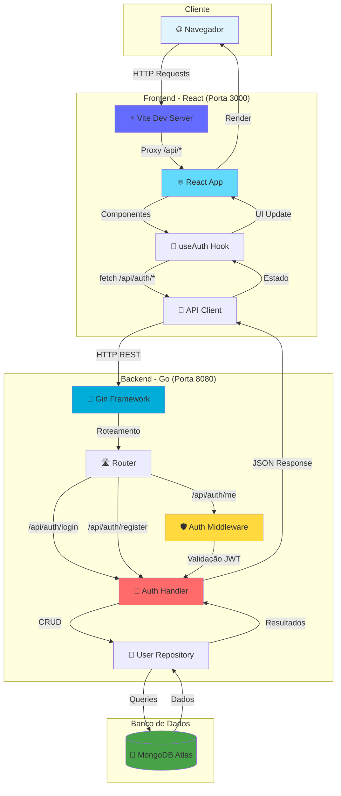
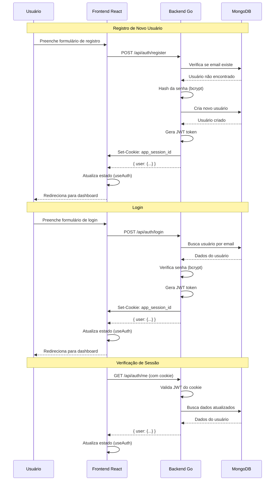

# Order Platform

Uma plataforma moderna e escalável para gerenciamento de pedidos, construída com tecnologias de ponta para oferecer uma experiência de usuário excepcional e uma arquitetura robusta e fácil de manter.

## 📋 Sobre o Projeto

O Order Platform é um sistema completo de gerenciamento de pedidos que combina uma interface moderna e intuitiva (React) com uma arquitetura backend robusta (Go). A plataforma foi desenvolvida com foco em escalabilidade, manutenibilidade e experiência do usuário.

## 🏗️ Arquitetura do Projeto

O projeto é dividido em duas partes principais:

- **Frontend** (`FE/`) - Aplicação React com TypeScript, Vite, e componentes modernos
- **Backend** (`backend/`) - API RESTful desenvolvida em Go com Gin framework e MongoDB Atlas

### Diagrama da Arquitetura



### Fluxo de Autenticação



## 🛠️ Stack Tecnológica

### Frontend
- React 19 + TypeScript
- Vite para build e desenvolvimento
- Radix UI + Tailwind CSS
- React Query para gerenciamento de estado
- Wouter para roteamento

### Backend
- Go 1.21+
- Gin Framework
- MongoDB Atlas
- JWT para autenticação
- bcrypt para hash de senhas

## 🚀 Início Rápido

> **Novo no projeto?** 
> - **Windows:** Veja o [Guia de Início Rápido](./QUICK_START.md)
> - **WSL/Linux:** Veja o [Guia de Setup WSL](./SETUP_WSL.md)

### Pré-requisitos

- **Node.js** 18+ (para frontend) - [Windows](https://nodejs.org/) | [WSL/Linux](./INSTALL_NODE_WSL.md)
- **Go** 1.21+ (para backend) - [Instalar no Windows](./INSTALL_GO_WINDOWS.md)
- **pnpm** 10.4.1+ (gerenciador de pacotes) - opcional, npm também funciona
- **MongoDB Atlas** (conta gratuita disponível) - [Criar conta](https://www.mongodb.com/cloud/atlas)
- **Make** - Para usar o Makefile - [Instalar no Windows](./INSTALL_MAKE_WINDOWS.md)

### Instalação Rápida

#### Opção 1: Usando Makefile (Recomendado - Funciona no Windows também!)

**No Windows:** Use Git Bash ou instale make (veja [INSTALL_MAKE_WINDOWS.md](./INSTALL_MAKE_WINDOWS.md))

```bash
# Clone o repositório
git clone <url-do-repositorio>
cd order-platform

# Ver comandos disponíveis
make help

# Setup completo (configura backend e frontend)
make setup

# Ou configure separadamente
make setup-backend
make setup-frontend
```

#### Opção 2: Usando Scripts PowerShell (Windows - Alternativa)

```powershell
# Clone o repositório
git clone <url-do-repositorio>
cd order-platform

# Setup completo
.\setup.ps1
```

#### Opção 3: Manual

1. **Configure o Backend**:
```bash
cd backend
cp .env.example .env
# Edite o .env com suas credenciais
go mod download
```

2. **Configure o Frontend**:
```bash
cd FE
pnpm install
# ou npm install --legacy-peer-deps
```

### Executando o Projeto

#### Opção 1: Usando Makefile (Recomendado)

```bash
# No Windows: Use Git Bash ou terminal com make instalado
# No Linux/Mac: Use qualquer terminal

# Inicia backend e frontend (em janelas separadas no Windows)
make dev

# Ou separadamente
make dev-backend    # Backend na porta 8080
make dev-frontend   # Frontend na porta 3000
```

#### Opção 2: Usando Scripts PowerShell (Windows - Alternativa)

```powershell
# Inicia backend e frontend em janelas separadas
.\run-dev.ps1
```

#### Opção 3: Manual

1. **Terminal 1 - Backend**:
```bash
cd backend
go run cmd/server/main.go
```

2. **Terminal 2 - Frontend**:
```bash
cd FE
pnpm dev
# ou npm run dev
```

O backend estará disponível em `http://localhost:8080` e o frontend em `http://localhost:3000`.

**Importante:** O frontend está configurado com um proxy que redireciona todas as requisições `/api/*` para o backend Go em `http://localhost:8080`. Isso significa que você não precisa configurar CORS manualmente em desenvolvimento - o Vite faz o proxy automaticamente.

**Configuração de CORS:** A variável `CORS_ORIGINS` é **obrigatória** e deve ser configurada no `.env` do backend com as URLs permitidas, separadas por vírgula. 
  - **Desenvolvimento:** `CORS_ORIGINS=http://localhost:3000,http://localhost:5173,http://127.0.0.1:3000,http://127.0.0.1:5173`
  - **Produção:** `CORS_ORIGINS=https://meusite.com,https://www.meusite.com`
  - Não há valores padrão - você deve configurar explicitamente para cada ambiente.

### Comandos Disponíveis (Makefile)

Execute `make help` para ver todos os comandos disponíveis:

- `make setup` - Configura todo o ambiente
- `make dev` - Inicia backend e frontend (mata processos nas portas automaticamente)
- `make dev-backend` - Inicia apenas o backend (mata processo na porta 8080 se necessário)
- `make dev-frontend` - Inicia apenas o frontend (mata processo na porta 3000 se necessário)
- `make kill-port-backend` - Mata processos usando a porta 8080
- `make kill-port-frontend` - Mata processos usando a porta 3000
- `make kill-ports` - Mata processos nas portas 8080 e 3000
- `make build` - Build para produção
- `make test` - Executa testes
- `make clean` - Limpa arquivos de build
- E mais...

## 📝 Estrutura do Projeto

```
order-platform/
├── FE/                   # Frontend React
│   ├── client/           # Aplicação React
│   ├── server/           # (Legado - será removido)
│   └── README.md         # Documentação do frontend
├── backend/              # Backend Go
│   ├── cmd/              # Aplicação principal
│   ├── internal/         # Código interno
│   └── README.md         # Documentação do backend
├── Makefile              # Comandos para execução
└── README.md             # Este arquivo
```

## 🔧 Configuração

### Variáveis de Ambiente

#### Backend (`.env` em `backend/`)

O arquivo `.env` é criado automaticamente a partir de `backend/.env.example` quando você executa `make setup-backend`.

Edite `backend/.env` com suas credenciais reais após o setup.

**Variáveis importantes:**
- `CORS_ORIGINS`: **OBRIGATÓRIO** - URLs permitidas para CORS (separadas por vírgula). 
  - **Desenvolvimento:** `http://localhost:3000,http://localhost:5173,http://127.0.0.1:3000,http://127.0.0.1:5173`
  - **Produção:** `https://meusite.com,https://www.meusite.com`
  - Esta variável deve ser configurada explicitamente - não há valores padrão hardcoded

#### Frontend (`.env` em `FE/`)

O arquivo `.env` é criado automaticamente a partir de `FE/.env.example` quando você executa `make setup-frontend`.

Edite `FE/.env` com suas credenciais reais após o setup.

**Variáveis importantes:**
- `VITE_API_URL`: URL do backend Go
  - **Desenvolvimento (Opcional):** 
    - Deixe vazio ou não configure: o frontend usará `/api` que será redirecionado pelo proxy do Vite para `http://localhost:8080` (recomendado)
    - Ou configure `http://localhost:8080`: o frontend fará requisições diretas ao backend
  - **Produção (OBRIGATÓRIO):** `https://api.meusite.com` (URL completa do seu backend)

**Nota:** Os arquivos `.env.example` contêm templates com todas as variáveis necessárias. Eles são copiados para `.env` automaticamente durante o setup.

**Importante para WSL:** Se você estiver usando WSL e encontrar erros de DNS ao conectar ao MongoDB Atlas, verifique:
1. A URL do MongoDB deve incluir os parâmetros de query: `?retryWrites=true&w=majority`
2. O arquivo `.env` deve ser salvo como UTF-8 **sem BOM** (Byte Order Mark)
3. Se o problema persistir, tente configurar o DNS do WSL ou use o IP do servidor DNS do Windows

#### Integração Frontend-Backend

A integração entre frontend e backend funciona da seguinte forma:

1. **Desenvolvimento:**
   - O Vite (servidor de desenvolvimento do frontend) está configurado com um proxy que redireciona todas as requisições `/api/*` para o backend Go
   - **Opção 1 (Recomendada):** Deixe `VITE_API_URL` vazia ou não configure. O frontend usará `/api` que será redirecionado pelo proxy do Vite para `http://localhost:8080`
   - **Opção 2:** Configure `VITE_API_URL=http://localhost:8080` no frontend. O frontend fará requisições diretas ao backend (sem proxy)
   - **Configure `CORS_ORIGINS` no `.env` do backend** com: `http://localhost:3000,http://localhost:5173,http://127.0.0.1:3000,http://127.0.0.1:5173`

2. **Produção:**
   - **Configure obrigatoriamente** a variável `VITE_API_URL` no frontend com a URL completa do seu backend em produção
     - Exemplo: `VITE_API_URL=https://api.meusite.com`
   - **Configure obrigatoriamente** a variável `CORS_ORIGINS` no backend com as URLs permitidas (separadas por vírgula)
     - Exemplo: `CORS_ORIGINS=https://meusite.com,https://www.meusite.com`
   - O frontend usará a URL configurada diretamente para fazer requisições à API (sem proxy)

3. **Autenticação:**
   - O backend usa JWT tokens armazenados em cookies HTTP-only (`app_session_id`)
   - O frontend usa o hook `useAuth` que gerencia automaticamente o estado de autenticação
   - As requisições incluem `credentials: "include"` para enviar cookies automaticamente

## 🧪 Testes

### Backend
```bash
cd backend
go test ./...
```

### Frontend
```bash
cd FE
pnpm test
```

## 📄 Licença

Este projeto está sob a licença MIT.


Desenvolvido com ❤️ usando as melhores tecnologias modernas.
